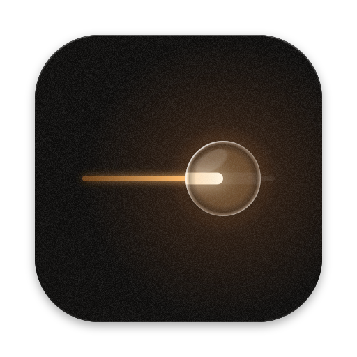

  

<h1 align="center">S9 Brightness</h1>

  

A macOS menu bar app that sets the hardware backlight of Samsung smart monitors (such as the ViewFinity S9) over your local network.

## Requirements

- macOS 14 or later
- Xcode 27 or later to build
- The monitor on the same network as your Mac, with **IP Remote** turned on:
  Settings › Connection › Network › Expert Settings › IP Remote

## Download

Get the signed and notarized DMG from [Releases](https://github.com/fardage/s9-brightness/releases), open it and drag S9 Brightness to Applications.

## Build

Open `S9Brightness/S9Brightness.xcodeproj` in Xcode and run the `S9Brightness` scheme. Run the tests with ⌘U.

## Use

On first launch a setup window finds the monitor. Click **Connect**, then select **Allow** on the monitor. Adjust brightness from the sun icon in the menu bar. Right-click a preset to set it to the current brightness.

Samsung's IP Control interface is undocumented and may change with firmware updates. This project is not affiliated with Samsung.

## License

MIT, see [LICENSE](LICENSE).
